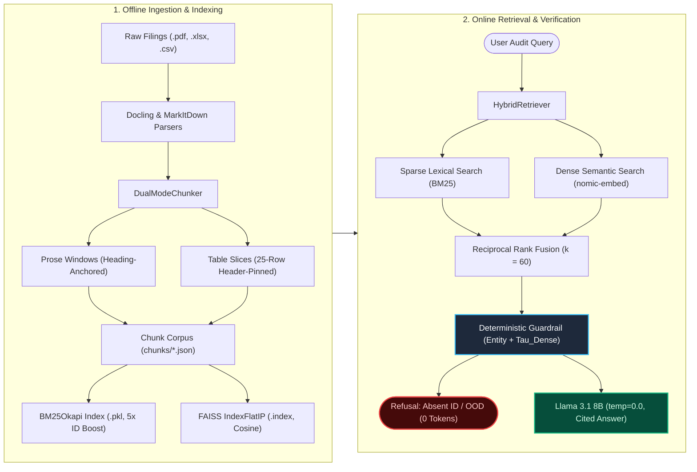
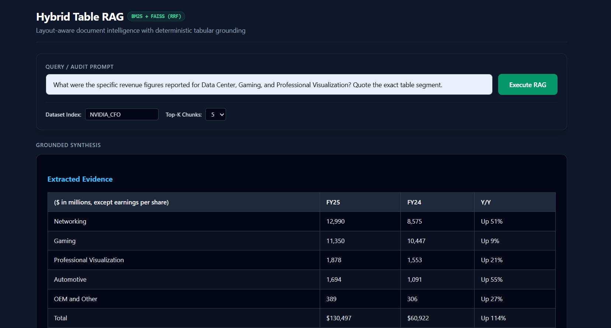
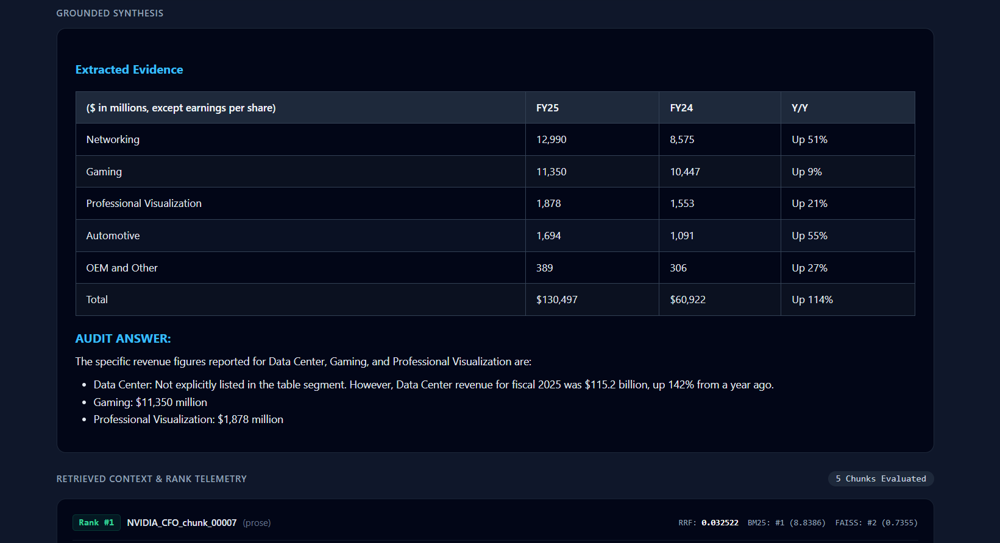
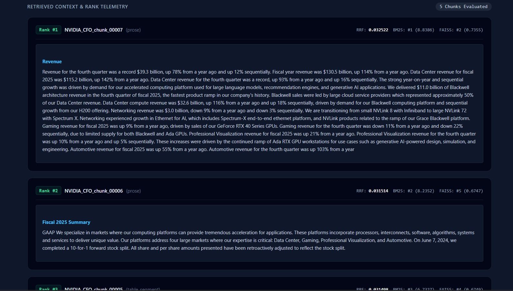
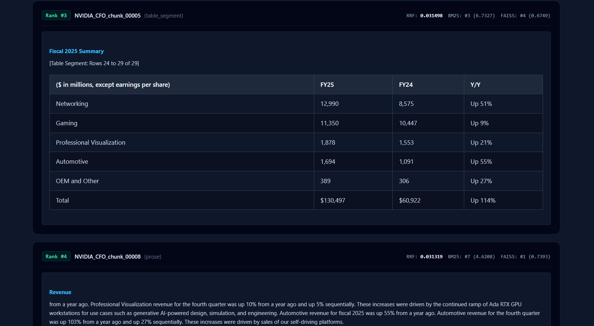

# DataHound-RAG

A local-first **Hybrid Retrieval-Augmented Generation (RAG)** pipeline engineered for financial filings, audit ledgers, and technical documents containing dense tables, featuring deterministic guardrails to reduce hallucination risk.

Standard RAG pipelines break on tabular enterprise documents for four reasons:
1. **Layout destruction:** Naive PDF text extractors flatten multi-column tables into unreadable token streams.
2. **Schema amnesia:** Fixed-size text splitters sever rows 26–500 from their column headers on row 1, leaving downstream chunks with unlabelled numbers.
3. **Single-retriever blind spots:** Dense embeddings (`FAISS`) collapse on exact alphanumeric identifiers (`eg. Transaction IDs like TR109`) and adjacent decimal columns, while lexical search (`BM25`) fails when users paraphrase domain concepts with zero keyword overlap.
4. **Row-substitution hallucinations:** When a queried identifier is absent from retrieved chunks, LLMs silently substitute values from neighbouring rows.

This repository systematically mitigates each failure mode—running locally on **Ollama** (`nomic-embed-text` + `Llama 3.1 8B`)—and ships with a modular IR, chunking, and RAG Triad evaluation suite (`eval_rag.py`) to benchmark retrieval trade-offs and error modes empirically.

---

## System Architecture



### Key Engineering Decisions

* **Header-Pinned Table Chunking (`DualModeChunker`):** Markdown tables are sliced into `25`-row windows (`2`-row overlap) with both the parent section heading and the Markdown header/separator rows re-injected at the top of *every* chunk so row #200 retains full column semantics.
* **Asymmetric Dense + Boosted Sparse Retrieval (`HybridRetriever`):**
  * **Sparse stream:** Identifier-preserving tokenizer (`TR109`, `05-01-2016`, `E-4017`) with stopword removal and a $5\times$ term-frequency boost on opaque record codes, excluding fiscal/calendar period shorthands (`FY25`, `Q4`) from destructive filtering.
  * **Dense stream:** L2-normalized `FAISS IndexFlatIP` (exact cosine similarity) using `nomic-embed-text` with asymmetric `search_document:` and `search_query:` prefixes and GPU batching.
  * **Reciprocal Rank Fusion (RRF):** Combines rankers without score-scale calibration via $\text{RRF}(d) = \sum_{i \in R} \frac{1}{k + r_i(d)}$ ($k = 60$), capping candidate pools on small corpora so bottom-half documents cannot accumulate phantom consensus credit.
* **Three-Layer Hallucination Mitigation Defense:**
  1. *Retrieval gate:* Returns empty context when a queried record ID (`TR9999`, `E-9999`) is absent across the entire index; ranks exact-ID chunks first and backfills remaining slots for multi-hop context when present.
  2. *Deterministic Python guardrail:* Rejects prompt injections, missing entity codes, and low-evidence out-of-domain queries (`lexical coverage < tau_lex` and `max_dense_cosine < tau_dense`, calibrated on held-out queries with zero test-set leakage) before calling the LLM.
  3. *Forensic system prompt:* Locks `temperature=0.0` (`num_ctx=4096`) and requires a verbatim `### Extracted Evidence` block prior to synthesis to constrain generation strictly to retrieved text.

---

## Empirical Benchmark Results

All benchmarks were executed locally against **Ollama** using `nomic-embed-text` (embeddings) and `llama3.1:8b-instruct-q4_K_M` (generation and JSON-constrained RAG Triad judging). Out-of-domain attacks are evaluated strictly via **Refusal Accuracy** so they never distort in-domain IR macro-averages.

> [!NOTE]
> **Evaluation Scope & Preliminary Results:** These benchmark metrics evaluate comparative ablation across retrieval and chunking strategies on focused test sets. With small sample sizes (8–12 queries), they serve as an engineering evaluation scaffold to identify trade-offs rather than proof of uniform accuracy across all enterprise domains.

### 1. Table-Chunking Ablation: Naive vs. Header-Pinned (`--suite chunking`)

60-row financial settlement ledger (`10` rows/chunk = `6` table segments + `1` prose chunk), evaluated on 8 single-row lookups requiring disambiguation between adjacent decimal columns (`fee_usd` vs. `tax_usd`), passing the top-1 chunk to the generator. Full report: [`rag_chunking_report.md`](rag_chunking_report.md).

| Strategy / Mode | Hit@3 | MRR@3 | Answer Correct (Top-1 Context) | Retrieval ms |
|---|---:|---:|---:|---:|
| Naive / BM25 | **1.000** | 0.938 | 0.500 | 0.2 |
| Naive / FAISS | 0.375 | 0.167 | 0.000 | 77.2 |
| Naive / Hybrid | **1.000** | 0.938 | 0.500 | 72.1 |
| **Header-Pinned / BM25** | **1.000** | **1.000** | **1.000** | **0.2** |
| Header-Pinned / FAISS | 0.500 | 0.208 | 0.000 | 94.9 |
| **Header-Pinned / Hybrid** | **1.000** | 0.938 | **0.875** | 89.9 |

* **Why Dense-only struggles on numeric tables:** `FAISS` drops to `Hit@3 = 0.375–0.500` (`Answer Correct = 0.000`) on exact dollar and transaction-ID lookups, whereas `BM25` and `Hybrid` achieve `Hit@3 = 1.000`.
* **Impact of Header-Pinning on Tabular LLM Accuracy:** Even when `BM25` and `Hybrid` retrieve the exact target row (`Hit@3 = 1.000`), `Naive` splitting strips column headers after chunk #1, causing LLM answer accuracy to drop significantly (`0.500` vs. `0.875–1.000`) due to lost column identities.

### 2. Dual-Stream Retrieval Ablation (`--suite retrieval`)

16-chunk technical corpus evaluated across 12 queries (`exact_keyword_match`, `semantic_intent`, `complex_multi_hop`, `out_of_domain_attack`), with `tau_dense = 0.503` calibrated on 4 disjoint held-out queries. Full report: [`rag_benchmark_report.md`](rag_benchmark_report.md).

| Mode | Hit Rate@5 | MRR@5 | Recall@5 | Refusal Acc (OOD) | False Refusal | Faithfulness | Answer Relevance | Context Precision |
|---|---:|---:|---:|---:|---:|---:|---:|---:|
| BM25 | 0.750 | 0.750 | 0.750 | 0.750 | 0.000 | 1.000 | 1.000 | 0.667 |
| FAISS | **1.000** | **1.000** | **1.000** | 0.750 | 0.000 | 1.000 | 1.000 | 0.917 |
| **Hybrid (RRF)** | **1.000** | 0.938 | **1.000** | 0.750 | 0.000 | 1.000 | 1.000 | **0.938** |

* On `semantic_intent` queries (zero lexical overlap), `BM25` collapses to `Hit@5 = 0.333`, while `FAISS` and `Hybrid` achieve `1.000` (`Hybrid` achieves the highest rank-aware `Context Precision` at `0.938`).

### 3. Real Enterprise PDF: NVIDIA Q4 FY25 CFO Commentary (`--use-production-index NVIDIA_CFO`)

27-chunk index parsed via IBM Docling and `DualModeChunker` from [`data/NVIDIA_CFO.pdf`](data/NVIDIA_CFO.pdf), evaluated on [`benchmarks/nvidia_cfo_eval.json`](benchmarks/nvidia_cfo_eval.json) (`tau_dense = 0.571` calibrated on [`benchmarks/nvidia_cfo_calibration.json`](benchmarks/nvidia_cfo_calibration.json)). Full report: [`rag_nvidia_cfo_report.md`](rag_nvidia_cfo_report.md).

| Mode | Hit Rate@5 | MRR@5 | Recall@5 | Exact Match MRR@5 | Semantic Hit@5 | Multi-Hop MRR@5 | Faithfulness | Answer Relevance |
|---|---:|---:|---:|---:|---:|---:|---:|---:|
| BM25 | 0.625 | 0.562 | 0.625 | **1.000** | 0.000 | 0.750 | 1.000 | 0.625 |
| FAISS | **0.875** | **0.812** | **0.875** | 0.833 | **0.667** | **1.000** | 1.000 | **0.750** |
| **Hybrid (RRF)** | **0.875** | 0.692 | **0.875** | **1.000** | **0.667** | **1.000** | 1.000 | **0.750** |

---

## Repository Structure

```text
DataHound-RAG/
├── ingestion.py                       # Stage 1: Layout-aware PDF (Docling) & Office/CSV (MarkItDown) parser
├── chunker.py                         # Stage 2: Header-pinned table & heading-anchored prose chunker
├── retriever.py                       # Stage 3: BM25Okapi + FAISS (Ollama embeddings) + RRF engine
├── app.py                             # Stage 4: Flask auditor API & UI with deterministic guardrails
├── eval_rag.py                        # Stage 5: CLI entrypoint for IR, Guardrail & RAG Triad ablation suite
├── evaluation/                        # Modular evaluation package
│   ├── models.py                      # Dataclasses (Chunk, EvalItem, RetrievalResult, GuardrailDecision)
│   ├── datasets.py                    # Built-in corpora, 60-row ledger generator & JSON validator
│   ├── metrics.py                     # Pure math: RRF, Hit@k, MRR@k, Recall@k, Context Precision@k
│   ├── retrievers.py                  # Embedders, BM25/Dense indices, RetrieverAdapter & NaiveChunker
│   ├── guardrails.py                  # DeterministicGuardrail, entity extractor & tau_dense calibration
│   ├── judge.py                       # OllamaLLM & JSON-constrained RAG Triad LLM-as-a-Judge
│   ├── runner.py                      # Benchmark and table-chunking orchestration runners
│   └── reporting.py                   # Pandas aggregation, ASCII dashboard & GFM Markdown exporter
├── templates/
│   └── index.html                     # Web UI frontend
├── data/
│   └── NVIDIA_CFO.pdf                 # Sample financial filing for reproducible benchmarking
├── benchmarks/
│   ├── nvidia_cfo_eval.json           # 12 labelled evaluation items for NVIDIA_CFO
│   └── nvidia_cfo_calibration.json    # 4 disjoint held-out queries for tau_dense calibration
├── tests/
│   └── test_eval_metrics.py           # 21 unit tests verifying RRF, MRR, CP@k, guardrails & GFM output
├── rag_benchmark_report.md            # Generated retrieval ablation report (DevOps corpus)
├── rag_chunking_report.md             # Generated chunking ablation report (60-row ledger)
├── rag_nvidia_cfo_report.md           # Generated real-PDF benchmark report (NVIDIA Q4 FY25)
└── requirements.txt                   # Python dependencies
```

---

## Security & Threat Model Considerations

- **Lexical vs. Semantic Injections:** The pre-retrieval regex gate deterministically intercepts explicit override commands (e.g., prompt extraction or instruction overrides) and non-existent entity IDs with zero LLM token overhead. However, heuristic regex alone cannot defend against indirect prompt injections embedded within untrusted third-party document text or PDF metadata.
- **Serving Path Integration:** While out-of-domain detection and refusal behaviors (`tau_dense`, cosine gating, injection patterns) are benchmarked in `evaluation/guardrails.py`, enterprise production hardening requires porting these checks into synchronous middleware within the Flask serving path (`app.py`) prior to retrieval and generation.
- **Parametric Context Boundaries & Tabular Reasoning:** Operating at `temperature=0.0` with a mandatory `### Extracted Evidence` citation protocol grounds Llama 3.1 8B to the retrieved Markdown context. However, multi-page financial reconciliation remains bounded by localized context window limits (`num_ctx=4096`) and the arithmetic limitations of autoregressive LLMs on dense tables. Complex queries requiring cross-statement math or full-ledger aggregation are best addressed by pairing hybrid retrieval with deterministic code execution (e.g., Pandas).

---

## Quickstart & Setup

### 1. Prerequisites

* **Python 3.10+**
* **[Ollama](https://ollama.com/)** running locally (`http://localhost:11434`) with the embedding and generation models pulled:

```bash
ollama pull nomic-embed-text
ollama pull llama3.1:8b-instruct-q4_K_M
```

### 2. Installation

```powershell
# Clone repository and create virtual environment (Windows PowerShell)
git clone https://github.com/MihirNagarkar/DataHound-RAG.git
cd DataHound-RAG
py -3 -m venv venv
.\venv\Scripts\Activate.ps1

# Install dependencies
pip install -r requirements.txt
```

---

## End-to-End Pipeline Usage

### Step 1: Ingest PDF or Spreadsheet to Layout-Preserved Markdown

Routes `.pdf` files through IBM Docling and `.xlsx` / `.csv` / `.docx` files through Microsoft MarkItDown (20 MB max guardrail):

```powershell
python ingestion.py data/NVIDIA_CFO.pdf
# Output -> processed_md/NVIDIA_CFO.md
```

### Step 2: Apply Dual-Mode Schema-Preserving Chunking

Slices narrative sections and re-injects parent headings + table headers across every table segment:

```powershell
python chunker.py processed_md/NVIDIA_CFO.md
# Output -> chunks/NVIDIA_CFO_chunks.json
```

### Step 3: Build & Query the Hybrid Index

Builds and serializes `BM25Okapi` (`.pkl`), normalized `FAISS` vectors (`.index`), and chunk metadata (`_chunks_meta.json`) into `indices/`:

```powershell
# Build index
python retriever.py build chunks/NVIDIA_CFO_chunks.json

# Test CLI hybrid search
python retriever.py search NVIDIA_CFO "Compute & Networking segment revenue Q4 FY25"
```

### Step 4: Launch the Web Auditor (`app.py`)

```powershell
# Optional overrides: $env:LLM_MODEL="llama3.1:8b-instruct-q4_K_M"; $env:PORT="8000"
python app.py
```

Open `http://localhost:8000` in your browser. The web interface provides real-time verification and rank telemetry:

| Query & Extracted Evidence | Grounded Audit Answer |
| :---: | :---: |
|  |  |

| Multi-Stream Rank Telemetry | Header-Pinned Table Slices |
| :---: | :---: |
|  |  |

Or query the REST endpoint directly via CLI:

```bash
curl -X POST http://localhost:8000/api/query \
  -H "Content-Type: application/json" \
  -d '{"dataset_name": "NVIDIA_CFO", "query": "How much Blackwell revenue was delivered in Q4 FY25?", "top_k": 3}'
```

---

## Running the Evaluation & Ablation Suite (`eval_rag.py`)

### Run Deterministic Unit Tests

Verifies RRF math, Hit@$k$, MRR@$k$, Recall@$k$, rank-aware Context Precision@$k$, entity extraction, guardrail rules, and Markdown table rendering without requiring Ollama:

```powershell
pytest tests -q
```

### Run Benchmarks

```powershell
# 1. Offline pipeline smoke test (character n-gram hashing embedder, no Ollama required)
python eval_rag.py --offline

# 2. Inspect held-out guardrail threshold calibration only
python eval_rag.py --calibrate --skip-generation

# 3. Full Dual-Stream Retrieval + Guardrail + RAG Triad benchmark -> rag_benchmark_report.md
python eval_rag.py --csv rag_benchmark_raw.csv

# 4. Naive vs. Header-Pinned Table-Chunking ablation -> rag_chunking_report.md
python eval_rag.py --suite chunking --csv rag_chunking_raw.csv

# 5. Benchmark a production HybridRetriever index -> rag_nvidia_cfo_report.md
python eval_rag.py `
  --use-production-index NVIDIA_CFO `
  --benchmark-file benchmarks/nvidia_cfo_eval.json `
  --calibration-file benchmarks/nvidia_cfo_calibration.json `
  --output rag_nvidia_cfo_report.md `
  --csv rag_nvidia_cfo_raw.csv
```

### Plugging in a Custom Retriever

Subclass `RetrieverAdapter` in [`evaluation/retrievers.py`](evaluation/retrievers.py) and implement `retrieve(query, k) -> RetrievalResult`:

```python
from evaluation.retrievers import RetrieverAdapter
from evaluation.models import RetrievalResult, RetrievedChunk

class MyCustomRetriever(RetrieverAdapter):
    name = "CustomHybrid"

    def retrieve(self, query: str, k: int) -> RetrievalResult:
        hits = my_pipeline.search(query, top_k=k)
        chunks = [
            RetrievedChunk(chunk_id=h.id, content=h.text, score=h.score, rank=idx)
            for idx, h in enumerate(hits, start=1)
        ]
        return RetrievalResult(chunks=chunks, diagnostics={"max_dense_cosine": hits[0].cosine if hits else 0.0})
```

